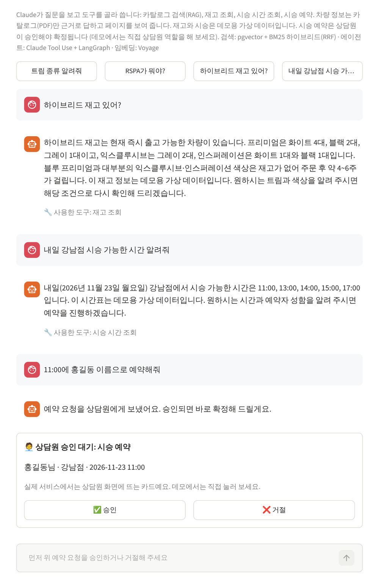
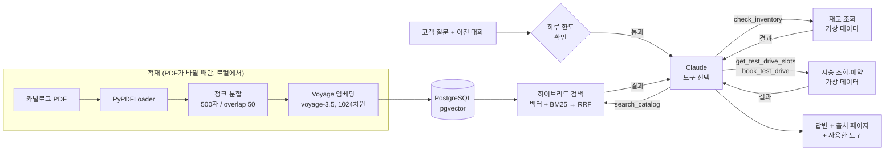

# AI CS Agent

자동차 카탈로그 PDF를 근거로 고객 질문에 답하고, **근거 페이지를 함께 보여 주는** RAG 상담 에이전트입니다.
Claude가 질문을 보고 **도구를 골라 씁니다(Tool Use)**: 카탈로그 검색, 재고 조회, 시승 시간 조회, 시승 예약.

**데모: https://ai-cs-agent.onrender.com**
(무료 서버라 한동안 접속이 없으면 잠듭니다. 첫 접속은 30~60초 걸릴 수 있어요. 하루 질문 수에 한도가 있습니다.)



## 구조



### Tool Use 반복문 (`rag/agent.py`)
1. 질문과 도구 설명서(`bind_tools`)를 Claude에 보냄
2. Claude가 `tool_calls`를 돌려주면 코드가 그 함수를 실행하고 결과를 `ToolMessage`로 붙여 다시 보냄
3. Claude가 도구를 더 부르지 않으면 그 글이 최종 답. 최대 5번에서 끊음 (비용·무한 반복 방지)

## 기술 스택
Python · LangChain(LCEL, Tool Calling) · Claude API · Voyage AI · PostgreSQL + pgvector · rank-bm25 · FastAPI · Streamlit · pytest · Docker · Render · Neon

## 주요 설계
- **Tool Use**: 도구 4개를 `@tool`로 정의 (docstring + 타입 힌트 → JSON 스키마). `Literal`로 선택지를 enum으로 고정해 잘못된 인자를 줄임
- **도구 에러는 Claude에게 되돌림**: 지난 날짜, 이미 찬 시간 같은 오류를 `ToolMessage(status="error")`로 보내 Claude가 스스로 다시 묻거나 고침
- **출처 검증**: 답에 적힌 (p.N) 중 실제로 검색된 페이지만 출처로 인정 → 지어낸 페이지는 걸러냄
- **환각 방지**: 카탈로그 내용만 근거로 답하고, 없으면 "카탈로그에서 찾을 수 없습니다"
- **하이브리드 검색**: 벡터 검색(뜻) + BM25(단어)를 RRF로 합침. 영문 약어(RSPA, T9M 등)와 다른 표기에 강함
- **검색 데이터는 DB 한 곳에**: BM25도 PDF 대신 DB에 저장된 청크를 읽음 → 서버에 PDF 없이 배포
- **비용 보호**: 하루 질문 수를 PostgreSQL upsert 한 문장으로 원자적으로 세고, 한도를 넘으면 LLM을 호출하지 않음 (API는 429)

## 검색 품질 (eval/)
직접 만든 26문항 평가셋(답 있는 질문 23개)으로 측정했습니다.

| 검색 | Hit@1 | Hit@3 | MRR |
|---|---|---|---|
| 벡터 | 0.87 | 1.00 | 0.928 |
| **하이브리드 (BM25 + 벡터, RRF)** | **0.91** | **1.00** | **0.957** |

자세한 실험 기록: [eval/notes.md](eval/notes.md)

## 배포
| 구성 | 사용 |
|---|---|
| 앱 | Render 무료 웹 서비스 (Streamlit) |
| DB | Neon 무료 PostgreSQL + pgvector |
| 비밀값 | API 키와 DB 주소는 환경변수로만 (`.env.example` 참고) |
| 비용 상한 | 하루 질문 한도(`DAILY_LIMIT`) + 탭당 10개 + Anthropic Console 월 한도 |

## 로컬 실행
```bash
python -m venv .venv && source .venv/bin/activate
pip install -r requirements.txt
cp .env.example .env              # API 키와 DB 정보 입력
docker compose up -d              # PostgreSQL + pgvector
# data/ 폴더에 카탈로그 PDF 넣기 (저작권 때문에 저장소에는 없음)
python -m scripts.ingest          # PDF → 청크 → 임베딩 → DB 저장 (처음 한 번)

streamlit run app.py              # 채팅 화면
uvicorn api.main:app --reload     # API 서버 (http://localhost:8000/docs)
pytest -q tests                   # 테스트
python -m eval.run_retrieval hybrid   # 검색 품질 측정
python -m rag.agent               # 에이전트에 예시 질문 3개 (도구 선택 확인)
```

## 한계와 다음 계획
- PDF 표가 줄 단위로 풀려 숫자의 칸 구분이 어려움
- 평가셋이 23문항으로 작아 1문항 차이는 노이즈일 수 있음
- 재고와 시승 데이터는 가상(mock)이고, 예약은 서버 메모리에만 저장되어 재시작하면 사라짐
- 다음: LangGraph 에이전트로 옮기기 → 시승 예약 전 상담원 승인(human-in-the-loop)