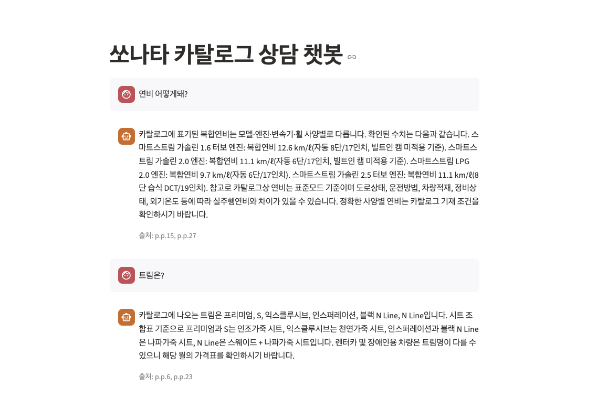
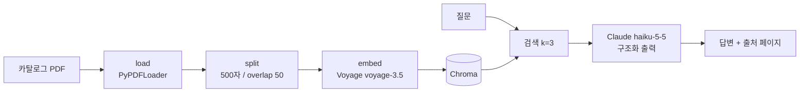

# AI CS Agent

자동차 카탈로그 PDF를 근거로 고객 질문에 답하고, **근거 페이지를 함께 보여 주는** RAG 챗봇입니다.
(로드맵: 1주차 RAG 챗봇 → 2주차 API 서버·평가셋 → 3주차 검색 개선 → 4주차 에이전트)



## 구조



## 기술 스택
Python · LangChain(LCEL) · Voyage AI(voyage-3.5, 1024차원) · Chroma · Claude(claude-haiku-5-5) · Pydantic · Streamlit

## 실행 방법
```bash
python -m venv .venv && source .venv/bin/activate
pip install -r requirements.txt
cp .env.example .env          # ANTHROPIC_API_KEY, VOYAGE_API_KEY 입력
# data/ 폴더에 카탈로그 PDF 넣기 (저작권 때문에 저장소에는 없음)
streamlit run app.py
```

## 주요 설계
- **출처 강제**: Pydantic `Answer(answer, sources)`로 구조화 출력 → 출처 누락 방지
- **환각 방지**: 카탈로그 내용만 근거로 답하고, 없으면 "찾을 수 없습니다"
- **임베딩 재사용**: `chroma_db`가 있으면 열기만 해서 재임베딩·중복 저장 방지

## 결과와 한계 (eval/notes.md)
| 질문 | 결과 |
|------|------|
| 기름 얼마나 먹어? | 엔진·인치별 연비를 출처(p.27, p.15)와 함께 정확히 답함 |
| 아반떼 연비는 얼마야? | "찾을 수 없습니다", 지어내지 않음 |
| 트림 종류 알려줘 | 답은 맞았으나 검색 1등은 엉뚱한 페이지(p.23) |

알게 된 한계
1. **표가 깨짐**: PDF 표가 줄 단위로 풀려 숫자의 칸 구분이 어려움
2. **각주가 이김**: 긴 주의 문구가 표·목록보다 검색 점수가 높음
3. **검색 누락**: k=3에 안 걸린 정보(하이브리드 연비)는 답에서 빠짐

## 다음 계획
- 질문 20개 평가셋 + Hit@5로 검색 품질 수치화
- 하이브리드 검색(BM25 + 벡터) + 리랭킹으로 개선 후 전후 비교
- FastAPI + pgvector로 API 서버화
